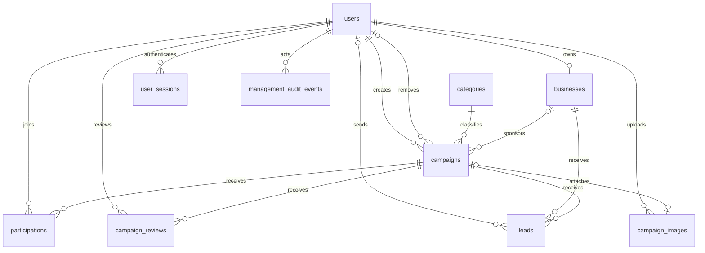

# Database specification

Current application schema: **10 tables**, created by the migrations in
`backend/src/database/migrations/` and mapped by the Sequelize models in
`backend/src/database/models/`. Migrations are the source of truth; do not create
tables manually from this reference. Sequelize also maintains its own
`SequelizeMeta` migration-history table, which is not an application table.

The first eight tables are created in dependency order: `users`, `categories`,
`businesses`, `campaigns`, `participations`, `campaign_reviews`, `leads`,
`user_sessions`. Later migrations add campaign image/deletion/version fields,
`management_audit_events` and `campaign_images`.

All application primary keys are auto-increment `INT` **except**
`campaign_images.image_id`, an opaque server-generated string. Foreign keys use
`ON DELETE RESTRICT`; campaign removal is a soft delete, not a cascade. Model
attributes use camelCase and map to the snake_case SQL columns below.

`management_audit_events.target_type/target_id` identifies a campaign or user;
that polymorphic target is not a database foreign key. The actor is a real user FK.

## users

| Column | Type | Rules |
|---|---|---|
| `user_id` | INT | PK, auto increment, not null |
| `full_name` | VARCHAR(100) | Not null |
| `email` | VARCHAR(150) | Not null, unique |
| `password_hash` | VARCHAR(255) | Not null, bcrypt hash; never returned by the API |
| `role` | ENUM | `public`, `business_owner`, `admin`; default `public` |
| `status` | ENUM | `active`, `suspended`; default `active` |
| `created_at`, `updated_at` | DATETIME | Not null; initial default current timestamp |

Registration accepts `accountType: user/business`, not an arbitrary role or admin
promotion. Suspension expires active sessions; reactivation requires a new login.

## categories

| Column | Type | Rules |
|---|---|---|
| `category_id` | INT | PK, auto increment, not null |
| `category_name` | VARCHAR(100) | Not null, unique |
| `description` | TEXT | Nullable |
| `created_at`, `updated_at` | DATETIME | Not null; initial default current timestamp |

## businesses

| Column | Type | Rules |
|---|---|---|
| `business_id` | INT | PK, auto increment, not null |
| `owner_id` | INT | Not null, unique FK to `users.user_id`; at most one business per user |
| `business_name` | VARCHAR(150) | Not null |
| `abn` | VARCHAR(20) | Nullable |
| `website` | VARCHAR(255) | Nullable |
| `description` | TEXT | Nullable |
| `created_at`, `updated_at` | DATETIME | Not null; initial default current timestamp |

A `business_owner` registration does not itself create this row. Implemented
GET/PUT `/api/business/me` reads and creates/updates the owning account's one row
in this existing table; no duplicate business table is needed.

## campaigns

| Column | Type | Rules |
|---|---|---|
| `campaign_id` | INT | PK, auto increment, not null |
| `business_id` | INT | Nullable FK to `businesses.business_id`; null means a cause campaign |
| `category_id` | INT | Not null, FK to `categories.category_id` |
| `created_by` | INT | Not null, FK to `users.user_id`; selected from authenticated account |
| `title` | VARCHAR(150) | Not null |
| `description` | TEXT | Nullable in legacy schema; new submissions require text |
| `target_audience` | VARCHAR(255) | Nullable |
| `start_date`, `end_date` | DATE | Nullable in legacy schema; new submissions require valid dates |
| `status` | ENUM | `pending`, `approved`, `rejected`; default `pending` |
| `image_url` | VARCHAR(500) | Nullable legacy fallback; new uploads use `campaign_images` |
| `created_at` | DATETIME | Not null; initial default current timestamp |
| `updated_at` | DATETIME(3) | Not null; initial default `CURRENT_TIMESTAMP(3)`; write-conflict version |
| `deleted_at` | DATETIME(3) | Nullable; non-null means removed from current campaign reads |
| `deleted_by` | INT | Nullable FK to `users.user_id` |
| `deletion_reason` | TEXT | Nullable |

Public queries require **both** `status = 'approved'` and `deleted_at IS NULL`.
Owner editing/resubmission returns the campaign to pending. Admin review and
owner/admin changes check the saved millisecond version before writing.
`campaigns_visible_status_created` indexes
`(deleted_at, status, created_at, campaign_id)`.

## participations

| Column | Type | Rules |
|---|---|---|
| `participation_id` | INT | PK, auto increment, not null |
| `user_id` | INT | Not null, FK to `users.user_id` |
| `campaign_id` | INT | Not null, FK to `campaigns.campaign_id` |
| `participated_at` | DATETIME | Not null; initial default current timestamp |
| `status` | ENUM | `joined`, `withdrawn`; default `joined` |

Unique `(user_id, campaign_id)` preserves one record across join/withdraw/rejoin.
The model has no automatic created/updated timestamps. Existing own participation
can be read or withdrawn after a campaign is hidden/removed; history must not leak
the campaign's then-private content.

## campaign_reviews

| Column | Type | Rules |
|---|---|---|
| `review_id` | INT | PK, auto increment, not null |
| `campaign_id` | INT | Not null, FK to `campaigns.campaign_id` |
| `admin_id` | INT | Not null, FK to `users.user_id` |
| `action` | ENUM | `approved`, `rejected`; not null |
| `comments` | TEXT | Nullable; rejection reason required by the API |
| `reviewed_at` | DATETIME | Not null; initial default current timestamp |

No automatic created/updated timestamps and no unique campaign constraint.
Separate review transitions retain earlier decisions; locking prevents two
successful decisions for the same pending transition.

## leads

| Column | Type | Rules |
|---|---|---|
| `lead_id` | INT | PK, auto increment, not null |
| `campaign_id` | INT | Not null, FK to `campaigns.campaign_id` |
| `business_id` | INT | Not null, FK to `businesses.business_id` |
| `user_id` | INT | Nullable FK to `users.user_id` for legacy compatibility |
| `name` | VARCHAR(100) | Not null |
| `email` | VARCHAR(150) | Not null |
| `phone` | VARCHAR(20) | Nullable |
| `message` | TEXT | Nullable in legacy schema |
| `created_at`, `updated_at` | DATETIME | Not null; initial default current timestamp |

The current enquiry API requires an authenticated active account and a non-empty
message. It derives the user and receiving business on the server; contact name,
email and optional phone are supplied explicitly by the sender and validated.
Guests cannot submit enquiries. Legacy rows missing `user_id` or `message` are
not presented as complete current enquiries. Only the linked business owner can
read the inbox.

## user_sessions

| Column | Type | Rules |
|---|---|---|
| `session_id` | INT | PK, auto increment, not null |
| `user_id` | INT | Not null, FK to `users.user_id` |
| `token` | VARCHAR(255) | Not null, unique; private JWT session token |
| `login_at` | DATETIME | Not null; initial default current timestamp |
| `logout_at` | DATETIME | Nullable |
| `ip_address` | VARCHAR(45) | Not null; IPv6-safe length |
| `user_agent` | VARCHAR(255) | Not null; trimmed/truncated, fallback `Unknown` |
| `status` | ENUM | `active`, `expired`; default `active` |

Login creates an active row. Logout expires that session and sets `logout_at`.
Protected routes verify the current active session and account, not just the JWT.
`user_sessions_owner_status` indexes `(user_id, status)`.

## management_audit_events

| Column | Type | Rules |
|---|---|---|
| `audit_id` | INT | PK, auto increment, not null |
| `actor_id` | INT | Not null, FK to `users.user_id` |
| `target_type` | ENUM | `campaign`, `user`; not null |
| `target_id` | INT | Not null; logical ID selected by `target_type`, not a FK |
| `action` | ENUM | `campaign_unpublished`, `campaign_deleted`, `user_suspended`, `user_reactivated`; not null |
| `previous_state`, `new_state` | JSON | Not null; bounded state snapshots |
| `reason` | TEXT | Nullable |
| `occurred_at` | DATETIME(3) | Not null; supplied by the service |

No automatic created/updated timestamps. `management_audit_target_time` indexes
`(target_type, target_id, occurred_at, audit_id)`. Soft deletion retains the event
and dependent records rather than erasing the audit trail.

## campaign_images

| Column | Type | Rules |
|---|---|---|
| `image_id` | VARCHAR(64) | String PK, not null; opaque `img_` reference |
| `owner_id` | INT | Not null, FK to `users.user_id` |
| `storage_key` | VARCHAR(100) | Not null, unique; private generated filename, never a signed URL |
| `content_type` | VARCHAR(32) | Not null; validated JPEG/PNG/WebP MIME type |
| `size_bytes` | INT UNSIGNED | Not null; encoded file size |
| `expires_at` | DATETIME(3) | Not null; expiry applies only while unattached |
| `campaign_id` | INT | Nullable, unique FK to `campaigns.campaign_id`; at most one attached image per campaign |
| `created_at`, `updated_at` | DATETIME | Not null; managed by Sequelize, no SQL default |

Both new FKs use `ON UPDATE CASCADE` as well as `ON DELETE RESTRICT`.
Indexes: `campaign_images_owner_unattached` on
`(owner_id, campaign_id, expires_at)` and `campaign_images_cleanup` on
`(campaign_id, expires_at)`.

Files are private persistent storage outside the release/web root. Unattached
images expire after 24 hours; attached photos are retained even after the original
expiry or campaign soft deletion. Delivery rechecks approval, deletion,
association and, for private tickets, the current account/session.

## Later migrations

| Migration | Change |
|---|---|
| `20260912062417-add-image-url-to-campaigns` | Legacy nullable `image_url` |
| `20261013090000-campaign-updated-at-milliseconds` | `updated_at` becomes DATETIME(3) |
| `20261013220000-add-campaign-management` | Deletion metadata, visibility/session indexes, audit table; `deleted_by`/`actor_id` use ON UPDATE CASCADE |
| `20261013221000-create-campaign-images` | Shared image metadata and indexes |

These additions preserve existing rows. Do not undo migrations or hard-delete
records as part of a routine deployment/rollback. See the
[API contracts](api/api-contract.md) for authentication, ownership, validation and
response rules that SQL nullability alone does not enforce.
